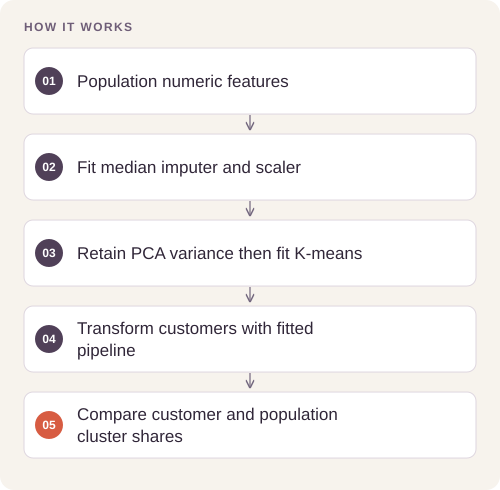

# Customer Segmentation Pipeline

Identify differences between customer and reference-population segments while making missing-data filtering and representation bias explicit.

## Implementation

A numeric-feature segmentation pipeline fitted on population data, with imputation, scaling, PCA, K-means, and customer representation ratios.



## Try a small example

A small offline fixture exercises the public implementation. It demonstrates the behavior shown below; it does not replace the historical dataset, benchmark or production validation.

After the local setup below, run from the repository root:

```sh
python examples/quickstart.py
```

The [example source](examples/quickstart.py), [captured output](examples/expected-output.txt) and [execution record](examples/environment.json) keep this demonstration inspectable. Floating-point values may vary with library versions.

Observed output from this run:

```text
[
  {
    "cluster": 0,
    "population_share": 0.5,
    "customer_share": 0.0,
    "representation_ratio": 0.0
  },
  {
    "cluster": 1,
    "population_share": 0.5,
    "customer_share": 1.0,
    "representation_ratio": 2.0
  }
]
```

## Completed study

The saved pipeline configures 64 modeled features, 27 principal components, and 10 clusters. Public notebook outputs are cleared; source records, individual profiles, centroids, and population/customer exports are not included.

These historical figures describe the completed study. This refactored standalone implementation has separate validation and has not been used to recertify the historical benchmark. The public release contains the portable core and focused tests.

## Run locally

Python 3.11 or later.

```sh
python -m venv .venv
source .venv/bin/activate
python -m pip install -r requirements.txt
python smoke_test.py
python segmentation.py /path/to/population.csv /path/to/customers.csv
```

Prepare your own inputs as described in [DATA.md](DATA.md). Tests use generated fixtures and do not need credentials or provider calls. [VALIDATION.md](VALIDATION.md) records their scope.

## Practical relevance and limitations

Cluster labels are arbitrary and descriptions are exploratory. Filtering high-missingness records changes the population being modeled. Reproduction requires independent authorized access to the original input files.
